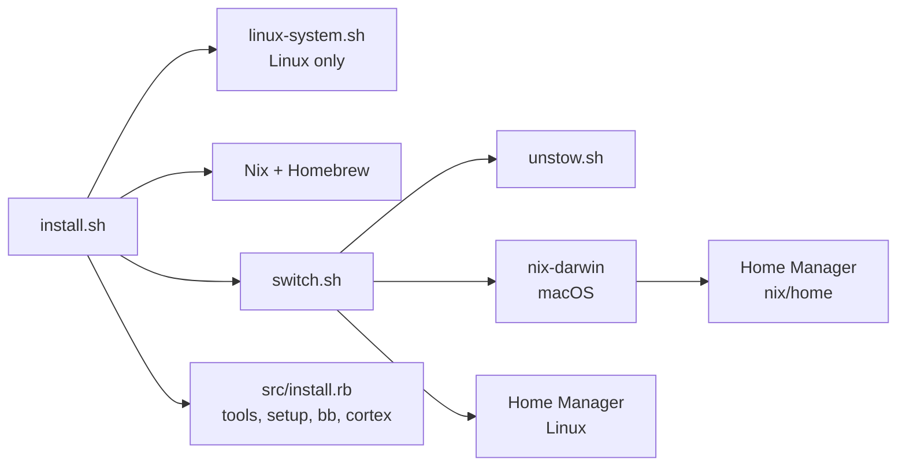

# Architecture

## Overview

A Nix flake describes each machine. On macOS, nix-darwin applies the system part (Homebrew
casks, fonts, Touch ID for sudo) and runs Home Manager for the user. On Linux, Home Manager
runs on its own and the distribution keeps the system part. Home Manager installs the
command-line tools, writes `~/.zshrc` and the git config, and links the files in `home/`
into `$HOME`. A small Ruby program then does what Nix cannot: it installs npm, pi and pipx
packages, sets up the GPG key, and applies bb and cortex state.



## Components

```
flake.nix                     # Inputs (nixpkgs, nix-darwin, Home Manager) and the configurations
flake.lock                    # Pinned input versions; `task update` refreshes it
nix/user.nix                  # User name, full name and email, shared by every machine
nix/unfree.nix                # The unfree packages the flake may install
nix/darwin/default.nix        # macOS: Homebrew casks, fonts, Touch ID sudo, Home Manager wiring
nix/home/default.nix          # Home Manager entry point for every machine
nix/home/packages.nix         # Command-line tools
nix/home/dotfiles.nix         # Links home/ into $HOME
nix/home/zsh.nix              # Builds ~/.zshrc from nix/home/zsh/*.zsh
nix/home/git.nix              # ~/.config/git/config
nix/home/ghostty.nix          # Ghostty's per-OS font size
nix/home/linux.nix            # Standalone Home Manager settings for Linux
nix/checks/git-identity.nix   # `nix flake check`: the main and work git identities
install.sh                    # Bootstrap: Nix, Homebrew, switch, then src/install.rb
src/scripts/switch.sh         # `task switch`: applies the flake
src/scripts/unstow.sh         # Removes links left by the old stow layout
src/scripts/linux-system.sh   # Linux packages and settings Home Manager cannot manage
src/install.rb                # The steps Nix does not manage (src/install/*.rb)
packages.yml                  # npm, pi and pipx packages
bb.yml                        # Desired bb state
home/                         # Dotfiles, linked into $HOME
```

## Configurations

| Output | Machine | Applied by |
|--------|---------|------------|
| `darwinConfigurations.personal` | A Mac without Tec | nix-darwin |
| `darwinConfigurations.work` | The Shopify Mac, where Tec supplies Nix, git, gh, Ruby, Node and pnpm | nix-darwin |
| `homeConfigurations.linux-x86_64` | Arch, Ubuntu or Debian on x86_64 | Home Manager |
| `homeConfigurations.linux-aarch64` | The same on ARM | Home Manager |

The two Mac profiles differ only in `profile == "work"` checks in `nix/home/packages.nix` and
`nix/home/git.nix`. nix-darwin writes the profile to `/etc/shell-profile`, so `task switch`
applies the same one next time.

## What nix-darwin leaves alone

The Mac already has a Nix installation, from the Determinate Systems installer or from Tec.
Both own the Nix daemon, `/etc/nix` and the Nix lines in `/etc/zshrc` and `/etc/bashrc`, so
the flake sets `nix.enable = false` and turns off nix-darwin's zsh and bash modules.
`~/.zshrc` puts the Nix profiles on PATH itself. nix-darwin also leaves
`/etc/ssl/certs/ca-certificates.crt` alone, because Tec or the MDM may own it and nix-darwin
stops its first activation on a file it would replace. It still writes new files of its own,
such as `/etc/pam.d/sudo_local` for Touch ID.

## Dotfile links

`nix/home/dotfiles.nix` reads `home/` from the flake source and links each entry to the
checkout with `mkOutOfStoreSymlink`, so an edit to a linked file applies at once. The link
chain is `~/x`, then a store file, then `~/src/github.com/kalindudc/shell/home/x`.

Tools write into some directories that also hold tracked files, such as `~/.pi/agent` or
`~/.agents/skills`. Those are listed in `realDirs`: they stay real directories in `$HOME`,
and their children are linked one by one. Every other directory is linked as a whole, so
files written into it (an extension's `node_modules`, `SKILL_NOTES.md`, the impact-review
private pack) land in the checkout, where `.gitignore` covers them.

A flake only sees files that git tracks. After adding a file to `home/`, run `git add` and
`task switch`. The nvim config is a git submodule, which the flake source leaves out, so it
is linked by name.

## Generated files

| File | Source |
|------|--------|
| `~/.zshrc` | `nix/home/zsh/zshrc.zsh`, which includes the other `nix/home/zsh/*.zsh` fragments |
| `~/.config/git/config` | `nix/home/git.nix` |
| `~/.config/ghostty/config-os` | `nix/home/ghostty.nix` (13 pt on macOS, 11 pt on Linux) |
| zsh completions | each Nix package's `share/zsh/site-functions`; `_todo` is built from `home/bin/todo` |

The zsh plugins (evalcache, fast-syntax-highlighting, oh-my-zsh's git plugin,
zsh-autosuggestions and zsh-completions) come from the Nix store in the same layout the old
git clones had, through `$ZSH_PLUGIN_DIR`. Each switch clears `~/.zsh-evalcache` and
`~/.zcompdump`, because both hold store paths that the switch replaces.

PATH order in `~/.zshrc`: pnpm and Atuin, then the Nix profiles, then Homebrew, then the
rest. Tec's init runs later and puts Tec first on the work Mac.

## Git identity

Git reads `~/.config/git/config` (Home Manager, read-only), then `~/.gitconfig` (writable,
for tools). The Home Manager file holds the settings and the identity from `nix/user.nix`,
then includes `~/.config/git/signing` (this machine's key, from `task setup`), then the
private repo's `git/gitconfig`, which switches work repos to the work identity. The
`git-identity` flake check tests that order.

## The Ruby steps

`src/install.rb` runs `tools`, `setup`, `bb` and `cortex`, always in that order:

| Step | Module | What it does |
|------|--------|--------------|
| `tools` | `src/install/tools.rb` | npm, pi and pipx packages from `packages.yml`; herdr plugins and its pi integration; the bb AppImage on x86_64 Linux |
| `setup` | `src/install/setup.rb` | GPG signing key and its GitHub upload; `npm install` in each pi extension; SKILL_NOTES.md templates |
| `bb` | `src/install/bb.rb` | Starts bb and applies `bb.yml` |
| `cortex` | `src/install/cortex.rb` | Builds cortex if needed and runs `cortex agents install` |

In a full install, a failing bb or cortex step prints a warning and the install goes on.
Run on its own, any failing step fails the command.

## Checks

`nix flake check` (or `task check`) evaluates every configuration and builds this system's
checks: the Mac systems on macOS, the Home Manager activation package on Linux, and the
`git-identity` test. CI runs it on macOS and Ubuntu, and also applies the Linux
configuration for a test user and starts zsh (`.github/workflows/check.yml`).

## Supported Platforms

| OS | Nix part | Native part |
|----|----------|-------------|
| macOS (Apple silicon) | nix-darwin and Home Manager | Homebrew casks (through nix-darwin) |
| Arch Linux | Home Manager | pacman, yay, flatpak |
| Ubuntu | Home Manager | apt, snap, flatpak |
| Debian | Home Manager | apt, flatpak |
